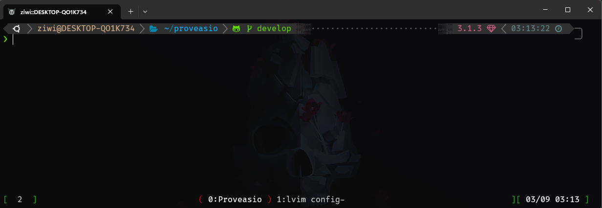

<div align="center">
  
</div>

<div align="center">

[](https://github.com/Ziwi01/proveasio/actions/workflows/build.yml)
[](./LICENSE)
[](https://github.com/Ziwi01/proveasio/commits)
[](https://ziwi01.github.io/proveasio)

</div>

## TL;DR

Set up an Ubuntu terminal environment for development and operations with one Ansible run, and keep it up to date by running it again.

Proveasio installs and configures the tools: zsh, tmux, Neovim, Git helpers, Kubernetes and cloud CLIs, language version managers and AI coding agents. Every tool comes with customizations that make day-to-day terminal work faster.

Supported systems: **Ubuntu 24.04** and **Ubuntu 26.04**, natively or on Windows WSL2. Both are tested in CI. On any other system, use the **Docker image**.

## Quick start

```bash
git clone https://github.com/Ziwi01/proveasio.git ~/proveasio
sudo ~/proveasio/prepare-ubuntu.sh
# close and reopen the terminal, then:
cd ~/proveasio/ansible && ansible-playbook -i inventory.yml setup-ubuntu.yml -K
```

Before the first run, set your git identity in `ansible/vars/overrides.yml` and read the [installation guide](https://ziwi01.github.io/proveasio/main/installation).

Or build it as a Docker image:

```bash
git clone https://github.com/Ziwi01/proveasio.git && cd proveasio
USER_UID=$(id -u) USER_GID=$(id -g) docker buildx bake
docker run -it --rm -v "$PWD":/workspace -w /workspace proveasio:local
```

See [Docker image](https://ziwi01.github.io/proveasio/main/docker/build).

## Features

A short summary of the included tools. For details see the [documentation](https://ziwi01.github.io/proveasio); for usage scenarios with examples, see [Usage](https://ziwi01.github.io/proveasio/usage/about).

- **Shell:** zsh with [oh-my-zsh](https://github.com/ohmyzsh/ohmyzsh) and the [powerlevel10k](https://github.com/romkatv/powerlevel10k) theme: syntax highlighting, autosuggestions, history and file search with [fzf](https://github.com/junegunn/fzf), alias reminders, [zoxide](https://github.com/ajeetdsouza/zoxide) directory jumping and more.

    <details>
      <summary><b>Example:</b> Terminal command line</summary>
      <div align="center">
        
      </div>
    </details>

- **[tmux](https://github.com/tmux/tmux):** splits shared with Neovim, saved and declarative sessions, fuzzy search of the scrollback.

- **Git:**
  - [lazygit](https://github.com/jesseduffield/lazygit), with AI-generated commit messages and commit splitting
  - [diff-so-fancy](https://github.com/so-fancy/diff-so-fancy), [git-fuzzy](https://github.com/bigH/git-fuzzy) and [hunk](https://github.com/modem-dev/hunk) for diffs and review
  - `ls` with Git status ([eza](https://github.com/eza-community/eza)), fzf branch checkout, many aliases
  - [gita](https://github.com/nosarthur/gita) to run commands on groups of repositories

- **Containers and Kubernetes:**
  - [Docker](https://www.docker.com/) with Compose, and [dry](https://github.com/moncho/dry)
  - [kubectl](https://kubernetes.io/docs/reference/kubectl/) with [kubecolor](https://github.com/kubecolor/kubecolor) and [kubeswitch](https://github.com/danielfoehrKn/kubeswitch)
  - [k9s](https://github.com/derailed/k9s), [kind](https://kind.sigs.k8s.io/), [Helm](https://github.com/helm/helm) with [helm-unittest](https://github.com/helm-unittest/helm-unittest)
  - [kubeconform](https://github.com/yannh/kubeconform), [dyff](https://github.com/homeport/dyff)
  - [Argo CD CLI](https://github.com/argoproj/argo-cd) and [Argonaut](https://github.com/darksworm/argonaut)

- **Infrastructure as code and cloud:**
  - [Terraform](https://github.com/hashicorp/terraform), [OpenTofu](https://github.com/opentofu/opentofu), [Terragrunt](https://github.com/gruntwork-io/terragrunt)
  - [Azure CLI](https://learn.microsoft.com/en-us/cli/azure/) with [kubelogin](https://github.com/Azure/kubelogin) and [az-account-switcher](https://github.com/abij/az-account-switcher)
  - [AWS CLI](https://github.com/aws/aws-cli)

- **Neovim:** replaces Vim. The default config, based on [AstroNvim](https://astronvim.com/), makes it a full IDE with language servers, Git tools and AI assistants. You can use your own config instead.

- **AI coding agents:**
  - [opencode](https://github.com/anomalyco/opencode) - terminal AI coding agent, also integrated into Neovim and lazygit
  - [ccmux](https://github.com/epilande/ccmux) - track AI coding agents in tmux: live session states, a status sidebar and picker, and desktop notifications (bridged to Windows toasts on WSL via [wsl-notify-send](https://github.com/stuartleeks/wsl-notify-send))

- **Command-line tools:** [ripgrep](https://github.com/BurntSushi/ripgrep), [fd](https://github.com/sharkdp/fd), [bat](https://github.com/sharkdp/bat), [jq](https://jqlang.org/), [yq](https://mikefarah.gitbook.io/yq/), [fx](https://github.com/antonmedv/fx), [curlie](https://github.com/rs/curlie), [htop](https://htop.dev/), [bottom](https://github.com/ClementTsang/bottom), [gdu](https://github.com/dundee/gdu), [ShellCheck](https://github.com/koalaman/shellcheck), [pay-respects](https://github.com/iffse/pay-respects)

- **Languages and toolchains** (with version management): Python (pyenv, uv), Node (nvm), Go (gvm), Ruby (rvm), Java, Gradle, Groovy and Maven (SDKMAN!), Rust, plus Ansible and Puppet tooling.

## Documentation

- [Requirements](https://ziwi01.github.io/proveasio/main/requirements) and [Installation](https://ziwi01.github.io/proveasio/main/installation)
- [Docker image](https://ziwi01.github.io/proveasio/main/docker/build)
- [Customizations](https://ziwi01.github.io/proveasio/category/customizations): version pins, excludes, partial runs
- [Troubleshooting](https://ziwi01.github.io/proveasio/main/troubleshooting)

## Contributing

Fork the repository, create a branch from `develop`, make your changes and open a pull request against `develop`. See [TODO](./TODO.md) for ideas.

Before you open it, run the checks CI runs:

```bash
cd ansible && ansible-lint                                  # must report "Passed: 0 failure(s)"
cd ansible && ansible-playbook -i inventory.yml setup-ubuntu.yml --syntax-check
cd docs-web && npm install && npm run build                 # fails on broken links
```

Do not run the full playbook on your own machine just to test a change. The `Build` workflow runs it on a clean Ubuntu runner.

Adding a tool takes five edits: a task file in `ansible/roles/software/tasks/` (copy `eza.yml` or `hunk.yml`), its include in `tasks/main.yml`, a `github_packages` entry in `vars/main.yml`, a `check_software_<tool>` in `docker/test.sh`, and the docs in `docs-web/docs/`. Commits follow [Conventional Commits](https://www.conventionalcommits.org/) with a capitalized subject, for example `feat(software): Add curlie`.

Thanks in advance!

## Author

Eryk 'Ziwi' Kozakiewicz

## Mentions

- Windows setup was inspired by and mostly based on [lholota/dev-setup](https://github.com/lholota/dev-setup) by [Lukas Holota](https://github.com/lholota)
- The SDKMAN! installation is based on [Comcast/ansible-sdkman](https://github.com/Comcast/ansible-sdkman) by Elliot Weiser
